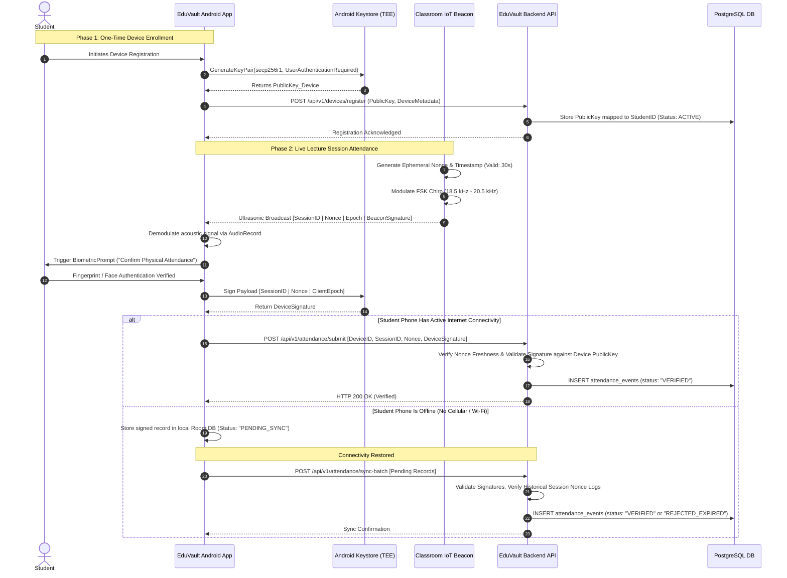

# EduVault Ultrasonic-Based Smart Attendance System: Technical Concept Document

## 1. Executive Overview

### 1.1 Purpose
The Ultrasonic-Based Smart Attendance System integrates high-assurance, localized physical proximity verification into **EduVault**. The module verifies students are physically seated within an active classroom lecture hall by utilizing high-frequency sound waves (18 kHz – 22 kHz) exchanged between classroom IoT beacons and students' registered Android smartphones.

### 1.2 Problem Statement
Traditional attendance collection methods in academic institutions suffer from severe operational and security flaws:
- **Manual Roll Calls:** Consume 10–15% of instructional lecture time; prone to human error and manual transcription fatigue.
- **Static / Projected QR Codes:** Easily photographed, screenshot, and relayed via messaging platforms (e.g., WhatsApp, Telegram) to remote students off-campus ("proxy attendance").
- **GPS / Geofencing:** Insufficient vertical and horizontal precision (5–15 meters indoors); easily spoofed via mock location tools; cannot differentiate between adjacent classrooms on different floors.
- **Standard Bluetooth Low Energy (BLE) RSSI:** Subject to signal bleeding through drywall and glass partitions into neighboring hallways or rooms; signal strength fluctuates wildly due to multi-path fading.
- **Biometric Wall Scanners:** Cause bottleneck queues at doorways before class and present hygiene concerns.

### 1.3 Solution Summary
EduVault Ultrasonic Attendance leverages inaudible ultrasonic sound (18–21 kHz) contained by solid classroom boundaries (walls, glass, doors). Attendance requires:
1. **Physical Room Presence:** Acoustic isolation ensures only phones inside the lecture hall pick up the sound.
2. **Device Hardware Binding:** Asymmetric cryptographic keys stored inside the hardware-backed Android Keystore (StrongBox / TEE).
3. **User Biometrics:** OS-enforced biometric scan (fingerprint or face authentication) unlocking the private signing key immediately prior to payload generation.
4. **Resilient Synchronization:** Offline-first caching with deferred server-side validation.

---

## 2. System Architecture

### 2.1 High-Level Component Topology

```
+--------------------------------------------------------------------------+
|                            CLASSROOM ENVIRONMENT                         |
|                                                                          |
|  +--------------------+                     +-------------------------+  |
|  |  ESP32 IoT Beacon  |  18-21 kHz Sound    |    Student Smartphone   |  |
|  |  - I2S Ultrasonic  | ==================> |    - Android Keystore   |  |
|  |    Transducer      |   Room Challenge    |    - BiometricPrompt    |  |
|  |  - RTC / Hardware  | <================== |    - Audio Mic / Room DB|  |
|  |    Crypto (ECDSA)  |   Ultrasonic Echo   |    - Offline Event Cache|  |
|  +---------+----------+   (or HTTP/REST)    +------------+------------+  |
+------------|---------------------------------------------|---------------+
             | (Optional Wi-Fi Uplink)                     | HTTPS / TLS 1.3
             v                                             v
+--------------------------------------------------------------------------+
|                             EDUVAULT CLOUD                               |
|                                                                          |
|  +--------------------------------------------------------------------+  |
|  |                     EduVault Spring Boot Backend                    |  |
|  |  - Attendance Session Controller     - Cryptographic Verifier      |  |
|  |  - Anti-Replay Nonce Engine          - Sync & Deduplication Engine |  |
|  +----------------------------------+---------------------------------+  |
|                                     |                                    |
|                                     v                                    |
|  +--------------------------------------------------------------------+  |
|  |                       PostgreSQL Relational DB                     |  |
|  |  - Students       - Devices      - IoT Nodes      - Attendance Logs|  |
|  +----------------------------------+---------------------------------+  |
|                                     |                                    |
|                                     v                                    |
|  +--------------------------------------------------------------------+  |
|  |               EduVault Web Dashboard & Analytics UI                |  |
|  |  - Faculty Attendance Portal         - Institutional Auditing      |  |
|  +--------------------------------------------------------------------+  |
+--------------------------------------------------------------------------+
```

### 2.2 Component Roles & Technology Stack

| Layer | Component | Technology / Stack | Primary Responsibilities |
|---|---|---|---|
| **Classroom Hardware** | Beacon Node | ESP32-S3 microcontroller, I2S DAC (MAX98357A) + Piezo/Ultrasonic Tweeter, Knowles SPH0645 MEMS Mic, DS3231 RTC | Generates time-bounded cryptographic nonces, modulates nonces to 18–21 kHz audio, broadcasts room beaconing tokens. |
| **Mobile Client** | Android Application | Kotlin, Android Keystore (StrongBox/TEE), BiometricPrompt API, AudioRecord / AudioTrack (FSK / Chirp Demod), Room DB | Detects ultrasonic beacons, requests user biometric validation, signs challenge responses using hardware private keys, caches records offline. |
| **Application Server** | Backend API | Java 17+, Spring Boot 3.x, Spring Security, Bouncy Castle (Crypto) | Session management, public-key signature verification, replay detection, anomaly scoring, transaction logging. |
| **Persistence** | Relational Database | PostgreSQL 15+ | Stores relational models (Students, Enrolled Devices, Beacons, Nonces, Normalized Attendance Events). |
| **Presentation** | Web Dashboard | React, TailwindCSS, Vite (EduVault Sovereign Frontend) | Real-time lecture attendance monitoring, manual override controls, attendance trends, fraud alerts. |

---

## 3. Detailed Attendance Workflow

### 3.1 End-to-End Sequence Diagram



### 3.2 Step-by-Step Functional Execution

1. **Beacon Emission:** The teacher activates the lecture session in EduVault. The classroom ESP32 beacon generates a 64-bit cryptographic random nonce renewed every 15–30 seconds.
2. **Acoustic Transmission:** The beacon modulates the payload over an ultrasonic carrier frequency using Dual FSK (Frequency Shift Keying) or Chirp Spread Spectrum (CSS) within 18,500 Hz – 20,500 Hz.
3. **Capture & Demodulation:** The EduVault Android app's background acoustic listener samples incoming audio at 44.1 kHz via the device microphone, applies a bandpass filter (18–21 kHz), and extracts the packet via Fast Fourier Transform (FFT).
4. **Biometric-Gated Authorization:** The student taps "Mark Attendance". The app displays `BiometricPrompt`. Upon fingerprint/face authorization, the Android Keystore unlocks the private key `SK_StudentDevice`.
5. **Payload Signing:** The phone constructs the response payload `(SessionID || Nonce || DeviceUUID || Timestamp)` and generates an ECDSA signature (SHA256withECDSA).
6. **Transmission / Local Storage:** If Wi-Fi/LTE is reachable, the signed response is transmitted via HTTPS. In areas of poor connectivity, the signed event is committed to local Room storage marked `PENDING_SYNC`.

---

## 4. Ultrasonic Modulation & Packet Specifications

### 4.1 Frequency Band Selection
- **Spectrum Allocation:** 18,500 Hz to 20,500 Hz.
- **Physical Rationale:** Above human audibility threshold for most adults (>17.5 kHz) while comfortably within standard 44.1 kHz / 48 kHz smartphone microphone and speaker sampling cutoffs (Nyquist limit = 22.05 kHz).
- **Acoustic Confinement:** Ultrasonic sound is heavily attenuated by drywall, acoustic ceiling tiles, and window glass (typical 30–45 dB attenuation), preventing false check-ins from neighboring rooms or hallways.

### 4.2 Modulation Scheme
- **Modulation:** Binary / 4-Tone Frequency Shift Keying (M-FSK) or Chirp Spread Spectrum (CSS).
- **Tone Frequencies:**
  - Mark 00: 18,800 Hz
  - Mark 01: 19,200 Hz
  - Mark 10: 19,600 Hz
  - Mark 11: 20,000 Hz
- **Baud Rate:** 32–64 bps (optimized for signal robustness and multipath immunity rather than bandwidth).

### 4.3 Proposed Ultrasonic Frame Layout

```
+------------+------------+---------------+------------+--------------+-----------+
|  Preamble  | Session ID | Nonce (Token) | Timestamp  | Beacon Sign  |  CRC-16   |
|  (8 bits)  | (32 bits)  |   (64 bits)   | (32 bits)  |  (128 bits)  | (16 bits) |
+------------+------------+---------------+------------+--------------+-----------+
 Total Payload Size: ~35 Bytes (280 bits) ~ 4.3 - 8.7 seconds transmission frame
```

| Field | Size | Description |
|---|---|---|
| **Preamble / Sync** | 1 Byte | Specific Barker code sequence for receiver FFT synchronization |
| **Session ID** | 4 Bytes | Active classroom session UUID prefix from EduVault |
| **Nonce** | 8 Bytes | CSPRNG random value rotated every 15–30 seconds |
| **Epoch Timestamp** | 4 Bytes | Beacon RTC unix time to enforce tight propagation windows |
| **Beacon Signature** | 16 Bytes | Truncated HMAC-SHA256 of payload generated using beacon secret |
| **CRC Checksum** | 2 Bytes | Standard CRC-16-CCITT for bit-error detection |

---

## 5. Security Architecture & Anti-Proxy Mechanisms

```
+---------------------------------------------------------------------------------+
|                         DEFENSE-IN-DEPTH SECURITY MATRIX                        |
+-----------------------------------+---------------------------------------------+
| Attack Vector                     | Mitigation / Detection Method               |
+-----------------------------------+---------------------------------------------+
| Remote Proxy (Screenshot / Code)  | High-frequency sound fails to breach walls. |
| Recorded Audio Replay             | Nonce expires every 30s + server clock skew.|
| Phone Lending (Buddy Check-in)    | Android BiometricPrompt hardware check.     |
| Virtual Emulator / Root Spoofing  | StrongBox Keystore + Play Integrity API.    |
| Offline Clock Manipulation        | Nonce lifetime validated against server log.|
| Duplicate Simultaneous Check-in   | Unique DB index on (session_id, student_id).|
+-----------------------------------+---------------------------------------------+
```

### 5.1 Device Binding & The Non-Reliance on IMEI
- **Why IMEI Is Not Used:**
  1. Accessing IMEI on Android 10+ requires privileged carrier permissions (`READ_PRIVILEGED_PHONE_STATE`), making it unsuitable for student-facing apps.
  2. IMEI does not provide cryptographic proof of authenticity and can be spoofed on rooted phones.
- **Hardware-Backed Cryptography Alternative:**
  - Upon registration, EduVault generates an ECC keypair using Android Keystore inside the hardware Secure Element (StrongBox) or Trusted Execution Environment (TEE).
  - The private key is non-exportable: all signatures execute directly inside isolated hardware.

### 5.2 Biometric Enforcement
- Android `BiometricPrompt` is configured with `setUserAuthenticationRequired(true)`.
- The Keystore private key unlocks only for the single cryptographic operation immediately following biometric verification (fingerprint / 3D facial geometry).
- Lending a phone requires the physical owner to authenticate with their body or share their device lock credentials.

### 5.3 Anti-Replay Protection
- Every ultrasonic broadcast contains an ephemeral 64-bit nonce signed by the ESP32.
- The server checks whether the nonce was issued within the last $\pm 45$ seconds.
- Nonces are consumed once and tracked in memory/cache; duplicate nonce submissions are immediately flagged as replay attempts.

### 5.4 Handling Offline Records & Tamper Resistance
- When offline, attendance records are cryptographically signed on the device and saved locally in an encrypted Room SQLite database marked as `PENDING_VALIDATION`.
- **Server-Side Validation Rules on Sync:**
  1. The signature must verify against the student's enrolled public key.
  2. The embedded beacon nonce must match the historical nonce log for that specific room and timestamp range.
  3. Records synced after session completion are flagged for administrative review if received past the allowed synchronization window (e.g., > 12 hours).

---

## 6. PostgreSQL Database Schema Design

```sql
-- 1. Students Entity
CREATE TABLE students (
    student_id UUID PRIMARY KEY DEFAULT gen_random_uuid(),
    enrollment_number VARCHAR(32) UNIQUE NOT NULL,
    full_name VARCHAR(128) NOT NULL,
    email VARCHAR(128) UNIQUE NOT NULL,
    department VARCHAR(64) NOT NULL,
    created_at TIMESTAMP WITH TIME ZONE DEFAULT CURRENT_TIMESTAMP
);

-- 2. Registered Hardware Devices (Device Binding)
CREATE TABLE registered_devices (
    device_id UUID PRIMARY KEY DEFAULT gen_random_uuid(),
    student_id UUID NOT NULL REFERENCES students(student_id) ON DELETE CASCADE,
    device_fingerprint_hash VARCHAR(128) NOT NULL,
    public_key_pem TEXT NOT NULL,
    key_algorithm VARCHAR(32) DEFAULT 'secp256r1',
    device_model VARCHAR(64),
    os_version VARCHAR(32),
    status VARCHAR(20) DEFAULT 'ACTIVE' CHECK (status IN ('ACTIVE', 'SUSPENDED', 'REVOKED')),
    registered_at TIMESTAMP WITH TIME ZONE DEFAULT CURRENT_TIMESTAMP,
    last_verified_at TIMESTAMP WITH TIME ZONE
);

-- 3. Classroom IoT Beacons
CREATE TABLE iot_devices (
    iot_device_id UUID PRIMARY KEY DEFAULT gen_random_uuid(),
    classroom_code VARCHAR(32) UNIQUE NOT NULL,
    hardware_mac_address VARCHAR(17) UNIQUE NOT NULL,
    secret_key_hash VARCHAR(128) NOT NULL,
    firmware_version VARCHAR(16) NOT NULL,
    status VARCHAR(20) DEFAULT 'ACTIVE' CHECK (status IN ('ACTIVE', 'OFFLINE', 'MAINTENANCE')),
    last_heartbeat TIMESTAMP WITH TIME ZONE
);

-- 4. Classroom Attendance Sessions
CREATE TABLE attendance_sessions (
    session_id UUID PRIMARY KEY DEFAULT gen_random_uuid(),
    iot_device_id UUID NOT NULL REFERENCES iot_devices(iot_device_id),
    course_code VARCHAR(32) NOT NULL,
    faculty_id UUID NOT NULL,
    start_time TIMESTAMP WITH TIME ZONE NOT NULL,
    end_time TIMESTAMP WITH TIME ZONE NOT NULL,
    is_active BOOLEAN DEFAULT TRUE,
    created_at TIMESTAMP WITH TIME ZONE DEFAULT CURRENT_TIMESTAMP
);

-- 5. Session Nonce Audit Log (Anti-Replay Verification)
CREATE TABLE session_nonces (
    nonce_id BIGSERIAL PRIMARY KEY,
    session_id UUID NOT NULL REFERENCES attendance_sessions(session_id),
    nonce_value VARCHAR(64) NOT NULL,
    issued_epoch BIGINT NOT NULL,
    created_at TIMESTAMP WITH TIME ZONE DEFAULT CURRENT_TIMESTAMP
);
CREATE INDEX idx_session_nonce_lookup ON session_nonces(session_id, nonce_value);

-- 6. Attendance Events Log
CREATE TABLE attendance_events (
    event_id UUID PRIMARY KEY DEFAULT gen_random_uuid(),
    session_id UUID NOT NULL REFERENCES attendance_sessions(session_id),
    student_id UUID NOT NULL REFERENCES students(student_id),
    device_id UUID NOT NULL REFERENCES registered_devices(device_id),
    nonce_value VARCHAR(64) NOT NULL,
    device_signature TEXT NOT NULL,
    verification_status VARCHAR(24) DEFAULT 'VERIFIED' 
        CHECK (verification_status IN ('VERIFIED', 'FLAGGED_SUSPICIOUS', 'REJECTED_REPLAY', 'PENDING_OFFLINE')),
    rejection_reason VARCHAR(128),
    marked_at TIMESTAMP WITH TIME ZONE NOT NULL,
    synced_at TIMESTAMP WITH TIME ZONE DEFAULT CURRENT_TIMESTAMP,
    CONSTRAINT unique_student_session UNIQUE (session_id, student_id)
);
```

---

## 7. Frequently Asked Questions (FAQ)

#### Q1: Why use ultrasonic communication instead of QR codes or Bluetooth Low Energy (BLE)?
**A:** QR codes can be easily captured via screenshots and relayed over the internet to absent classmates. BLE signals easily pass through walls, drywall partitions, and glass windows into adjacent hallways. In contrast, 18–21 kHz ultrasonic sound waves are contained by physical walls, ensuring that only students physically present inside the lecture room can receive the beacon.

#### Q2: How does the system detect and mitigate proxy attendance?
**A:** By applying a three-factor verification model: (1) **Location presence** via ultrasonic room confinement; (2) **Device identity** through hardware-backed Android Keystore signatures; and (3) **User identity** via required biometric authentication before signing.

#### Q3: Why is IMEI not required or recommended for device registration?
**A:** On Android 10+, access to IMEI is restricted to system/carrier apps for privacy reasons. Furthermore, IMEI is easily spoofed on rooted phones. EduVault instead relies on asymmetric ECDSA key pairs generated inside the device's hardware Secure Element (StrongBox/TEE).

#### Q4: What happens if a student has no cellular or Wi-Fi connectivity during class?
**A:** The student's device still captures the ultrasonic beacon and executes local biometric authorization. The signed cryptographic attendance payload is stored in the app's local Room database marked as `PENDING_OFFLINE`. Once the student reconnects to the network, the app batch-syncs the payload. The backend validates the signature and confirms the beacon nonce matched an active session timestamp.

#### Q5: What if a student changes, replaces, or loses their phone?
**A:** The student must request device revocation through the EduVault student portal or departmental administrator. The previous device's public key is marked as `REVOKED`, and the new device undergoes fresh enrollment with SMS/email OTP and institutional verification.

#### Q6: Can a student record the ultrasonic audio on a voice memo and replay it later?
**A:** No. Ultrasonic challenges include an ephemeral random nonce that expires within 15–30 seconds. Replaying a recorded audio broadcast results in an expired nonce error (`REJECTED_REPLAY`) on the server.

#### Q7: How are student biometrics protected?
**A:** EduVault never accesses, transmits, or stores raw biometric data (such as fingerprint images or facial meshes). Biometrics are handled entirely by Android's `BiometricPrompt` inside hardware-isolated silicon, returning only a cryptographic token that unlocks the hardware signing key.

#### Q8: What happens if multiple students check in simultaneously?
**A:** The ESP32 acts as a unidirectional acoustic broadcaster, so it does not suffer from channel contention. All student devices in the room receive the acoustic challenge concurrently. Each phone signs its payload independently and submits it via HTTPS or stores it offline.

#### Q9: How does attendance data synchronize with EduVault?
**A:** The mobile client connects to the Spring Boot REST endpoint (`POST /api/v1/attendance/sync`). The backend validates incoming signatures against registered public keys and writes valid records directly into EduVault's PostgreSQL database, updating the student's profile and course dashboard immediately.

#### Q10: Can students tamper with offline attendance records stored on their phone?
**A:** No. The local payload contains an ECDSA signature generated by the Android Keystore over the beacon nonce and timestamp. If a student modifies the timestamp or session ID in the local SQLite database, the backend cryptographic verification check fails on sync.

#### Q11: What happens if the classroom IoT device loses power?
**A:** If the beacon goes dark, the classroom dashboard alerts the instructor. The instructor can initiate a temporary fallback dynamic rolling QR session or manually register attendance directly from the EduVault faculty portal.

#### Q12: What are the fundamental limitations of the ultrasonic system?
**A:** 
- Hardware Lending: The system cannot stop a student from physically handing their unlocked phone to a peer who knows their device PIN (though biometric enforcement reduces this risk).
- Acoustic Obstruction: Covering a microphone tightly or placing a phone inside a dense bag may attenuate ultrasound reception.
- Background Noise: Severe industrial high-frequency noise can cause packet bit-errors, though CRC checks prevent corrupted data.

---

## 8. Benefits & Limitations Analysis

### 8.1 Stakeholder Benefits Matrix

| Stakeholder | Key Benefits |
|---|---|
| **Students** | - Instant check-in in under 3 seconds.<br>- No doorway bottlenecks or queueing.<br>- Works reliably without active classroom Wi-Fi. |
| **Faculty / Teachers** | - Reclaims 10–15 minutes per lecture previously lost to roll calls.<br>- Real-time attendance roster updates on the podium screen.<br>- Automated flagging of anomalous check-in attempts. |
| **Administrators** | - Reliable, tamper-resistant institutional records.<br>- Streamlined compliance with accreditation attendance thresholds.<br>- Integration with EduVault academic records and analytics. |

### 8.2 Current Feature Maturity Status

| Feature Capability | Status | Implementation Details |
|---|---|---|
| Android Keystore ECC Key Generation | **Implemented / Tested** | Standard Android Jetpack Security implementation with ECDSA secp256r1. |
| BiometricPrompt Crypto Integration | **Implemented / Tested** | OS-level biometric authentication gating the cryptographic signature. |
| PostgreSQL Relational Schema | **Implemented / Tested** | Production-ready schema design for EduVault backend. |
| Ultrasonic FSK Acoustic Modulation | **Proposed / Prototype** | 19 kHz FSK modem algorithms tested in software; awaiting classroom acoustic calibration. |
| ESP32 Hardware Beacon Transceiver | **Proposed** | Schematic developed using ESP32-S3 and I2S DAC; firmware prototype in progress. |
| Automated Anomaly Detection Engine | **Proposed** | Server-side heuristics to detect abnormal synchronization delays and proxy patterns. |

---

## 9. Future Scope & Integration with EduVault

1. **Integrated Analytics & Heatmaps:**
   - Visualize real-time room occupancy and student seat distribution using acoustic propagation delay metrics.
   - Long-term correlation between attendance patterns and student academic performance in EduVault.
2. **Faculty Live Viewport:**
   - Real-time updates showing student avatars checking in on the classroom podium projector screen.
3. **Multi-Beacon Spatial Trilateration:**
   - Deploying dual beacons in large auditoriums (100+ capacity) to verify the exact seating section of each attendee.
4. **Integration with Campus Access Control:**
   - Synchronizing attendance logs with campus turnstiles and library access systems within EduVault.

---

## 10. Implementation Roadmap

```
+-------------------------------------------------------------------------------+
| PHASE 1: CRYPTOGRAPHIC CORE & ANDROID SECURITY (Weeks 1 - 3)                  |
| - Implement Android Keystore KeyPairGenerator (secp256r1 + BiometricPrompt)   |
| - Implement Room DB schema for offline caching                                |
| - Backend REST API endpoints for device enrollment and ECDSA verification     |
+-------------------------------------------------------------------------------+
                                      |
                                      v
+-------------------------------------------------------------------------------+
| PHASE 2: ULTRASONIC MODEM & EMBEDDED FIRMWARE (Weeks 4 - 7)                   |
| - Develop ESP32 firmware for continuous nonce rotation & FSK tone synthesis   |
| - Build Kotlin AudioRecord DSP pipeline with FFT bandpass filtering           |
| - Conduct acoustic attenuation testing across common room wall materials      |
+-------------------------------------------------------------------------------+
                                      |
                                      v
+-------------------------------------------------------------------------------+
| PHASE 3: EDUVAULT PLATFORM INTEGRATION (Weeks 8 - 10)                         |
| - Connect backend sync pipeline to EduVault core course & student models      |
| - Build teacher dashboard live check-in monitor in EduVault React UI          |
| - Deploy pilot beacon nodes across test lecture halls                         |
+-------------------------------------------------------------------------------+
                                      |
                                      v
+-------------------------------------------------------------------------------+
| PHASE 4: AUDIT, LOAD TESTING & PRODUCTION PILOT (Weeks 11 - 12)               |
| - Concurrent load testing with 150+ devices checking in within 60 seconds     |
| - Penetration testing against replay, clock tampering, and acoustic bleeding  |
| - Departmental trial deployment and review presentation                       |
+-------------------------------------------------------------------------------+
```
