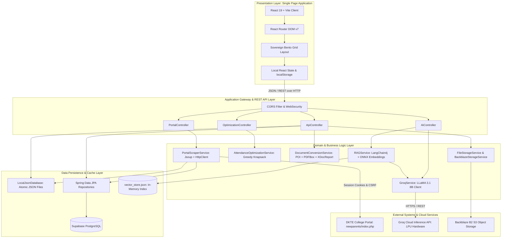
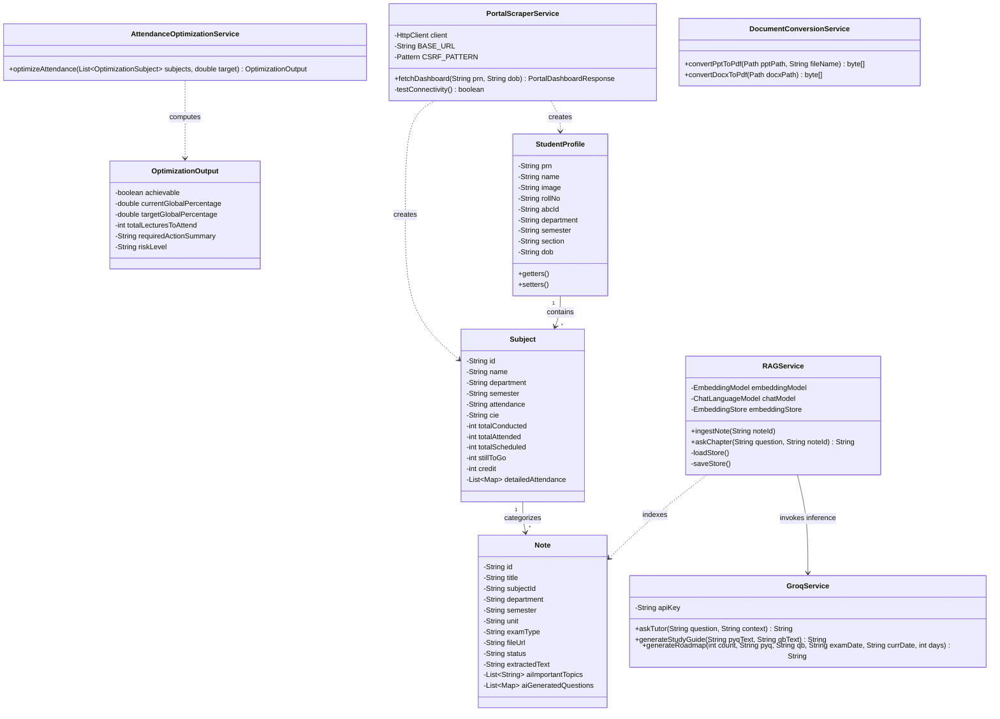
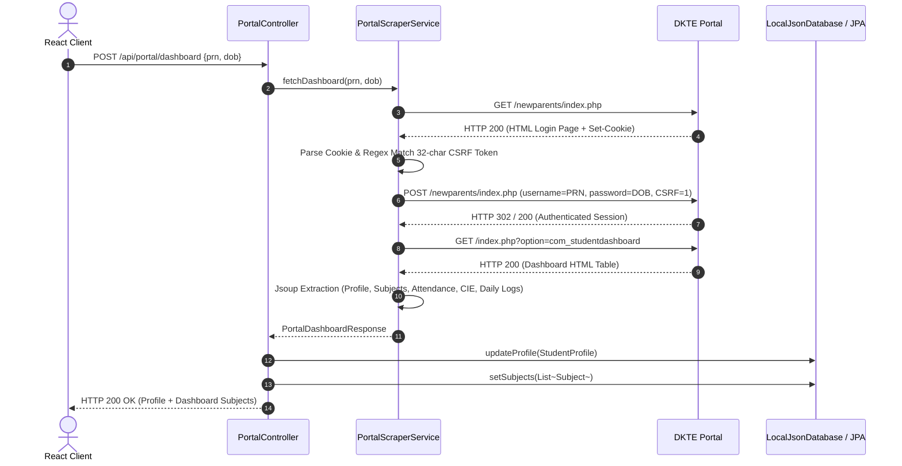
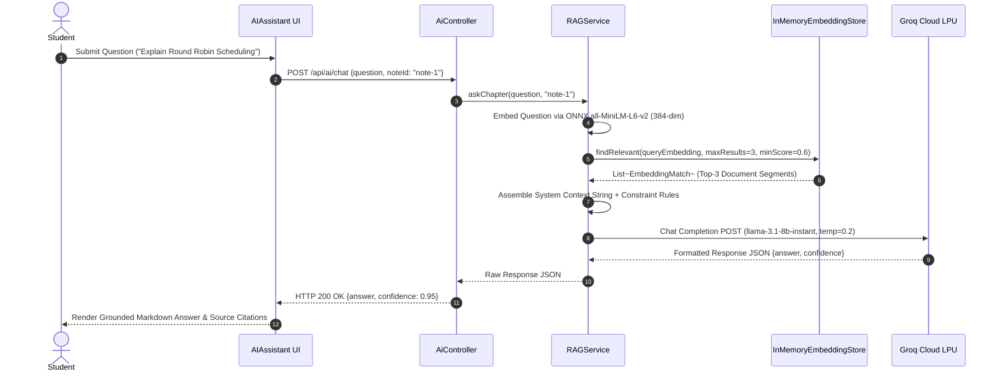
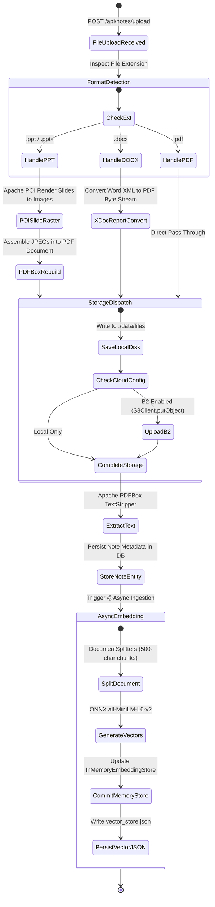
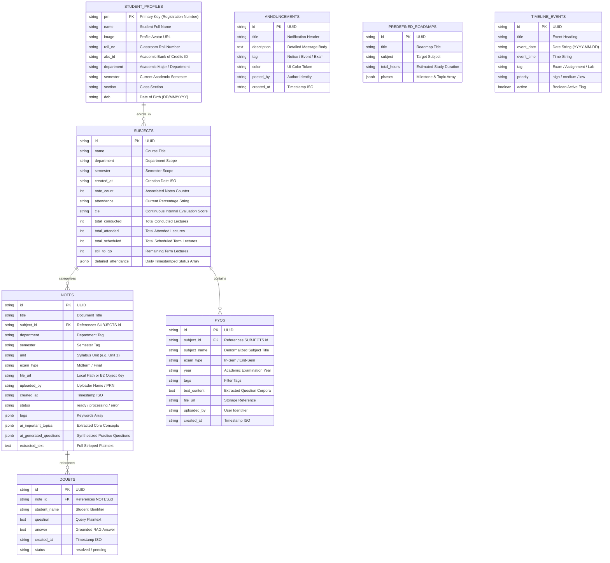

# Software Requirement Specification (SRS) & System Design Document
**Project Name:** EduVault (Sovereign Edition)  
**Document Version:** 1.0.0  
**Target Standard:** IEEE Std 830-1998 / ISO/IEC/IEEE 29148  

---

## 1. Software Requirement Specification (SRS)

### 1.1 Purpose
The purpose of this document is to provide a complete, definitive specification of the functional, non-functional, architectural, and behavioral requirements for the **EduVault** platform. This document serves as the formal design blueprint for engineering, implementation, verification, and academic evaluation.

### 1.2 Scope
EduVault is an intelligent, high-density academic management system and pedagogical assistant tailored for tertiary education students. It automates:
- Headless synchronization with legacy collegiate ERP portals (specifically DKTE Society's portal) to ingest attendance, Continuous Internal Evaluation (CIE) marks, and course rosters.
- Deterministic attendance optimization using a greedy knapsack allocation algorithm to calculate mandatory lecture attendance sequences and safe-Skip allowances.
- Curriculum-bounded, local-first Retrieval-Augmented Generation (RAG) using on-device ONNX embeddings (`all-MiniLM-L6-v2`) and Groq Cloud LPU inference (`LLaMA 3.1 8B`) for syllabus-grounded doubt resolution.
- Multi-format academic document ingestion, OCR/text extraction, and automatic PDF normalization (PPT, PPTX, DOCX to PDF).
- Historical examination trend analysis, predictive exam topic matrices, and calendar-constrained study roadmap synthesis.

### 1.3 Target Audience and User Characteristics
1. **Undergraduate/Postgraduate Students:** Primary users needing immediate visibility into attendance thresholds, automated safe-Skip calculations, centralized lecture materials, and syllabus-bounded AI tutoring.
2. **Academic Mentors & Faculty Advisors:** Secondary stakeholders who utilize student attendance heatmaps and CIE performance profiles for targeted academic intervention.
3. **System Administrators:** Responsible for configuring institution portal targets, storage backends (Local JSON / Supabase / Backblaze B2), and Groq API keys.

### 1.4 Operating Assumptions and Dependencies
- **Portal Availability:** The institutional portal (`https://online.dkte.ac.in/newparents/`) is accessible over public or campus intranet networks.
- **Client Runtime:** Modern Evergreen web browsers supporting WebAssembly, ES2022, and CSS Grid (Chrome 110+, Firefox 110+, Safari 16+).
- **Backend Runtime:** Java Virtual Machine (OpenJDK 17+) and Maven 3.8+ execution environment.
- **External AI Services:** Groq Cloud API access for fast LLM inference; fallback local execution for embedding generation via ONNX runtime.

---

## 2. Functional and Non-Functional Requirements

### 2.1 Functional Requirements (FR)

#### Module 1: Authentication and Portal Data Synchronization
- **FR-1.1 (Credential Handshake):** The system shall accept student credentials (PRN: Permanent Registration Number, and DOB: Date of Birth in `DD/MM/YYYY` format).
- **FR-1.2 (Headless CSRF Extraction):** The backend shall initiate an HTTP `GET` to the portal login page, extract the dynamic 32-character hexadecimal anti-CSRF token, and preserve the session cookie jar.
- **FR-1.3 (Authenticated Ingestion):** The backend shall execute an HTTP `POST` submission with student credentials and CSRF tokens, verify successful session establishment, and request the student dashboard.
- **FR-1.4 (DOM Parsing and Extraction):** The system shall use Jsoup to parse HTML tables, extracting:
  - Student profile data (Name, PRN, Roll No, Department, Semester, Section).
  - Enrolled subjects roster (Subject Name, Subject Code, Credits).
  - Attendance metrics (Total Conducted, Total Attended, Total Scheduled, Still To Go, Current Percentage).
  - CIE component scores.
  - Granular daily lecture timestamps and presence status (`Present` / `Absent`).
- **FR-1.5 (Persistence):** Extracted data shall be atomically saved into the local JSON persistence layer (`LocalJsonDatabase`) and synchronized with the PostgreSQL/Supabase database when configured.
- **FR-1.6 (Session Termination):** The system shall provide an explicit logout action that clears active profile records, cached subject tables, and client tokens.

#### Module 2: Attendance Optimization & Analytics
- **FR-2.1 (Threshold Parameterization):** The system shall permit users to configure a custom global target percentage (default: $75.0\%$).
- **FR-2.2 (Greedy Optimization Algorithm):** The backend shall execute a discrete greedy allocation algorithm that iteratively evaluates the marginal attendance benefit:
  $$\Delta B_i = \left(\frac{\text{Attended}_i + \text{ToAttend}_i + 1}{\text{Conducted}_i + \text{ToAttend}_i + 1}\right) - \left(\frac{\text{Attended}_i + \text{ToAttend}_i}{\text{Conducted}_i + \text{ToAttend}_i}\right)$$
  The engine shall iteratively allocate required attendance units to subjects yielding the maximum $\Delta B_i$ until the simulated aggregate reaches the target.
- **FR-2.3 (Safe-Skip Computation):** If current attendance exceeds the target threshold, the system shall compute the maximum number of allowable missed lectures ($Skip_{max}$) such that:
  $$\frac{\sum \text{Attended}_i}{\sum (\text{Conducted}_i + Skip_{max})} \ge \text{Target}$$
- **FR-2.4 (Risk Categorization):** The system shall categorize attendance status into discrete risk states:
  - `SAFE`: Current or simulated attendance meets target with a buffer $\ge 2\%$.
  - `AT_RISK`: Simulated attendance is within $[Target, Target + 2\%)$.
  - `CRITICAL`: Mathematically unachievable even with 100% attendance of remaining scheduled classes.
- **FR-2.5 (Activity Heatmap Generation):** The system shall aggregate granular daily attendance records across all subjects into a date-keyed map, calculating present/total intensity scores to render a GitHub-style annual activity calendar.

#### Module 3: Document Ingestion and Normalization
- **FR-3.1 (Multi-Format File Upload):** The system shall accept file uploads up to 50 MB in `.pdf`, `.ppt`, `.pptx`, and `.docx` formats.
- **FR-3.2 (Binary Conversion Pipeline):**
  - Presentation files (`.pptx`, `.ppt`) shall be parsed using Apache POI, rendered slide-by-slide onto offscreen `BufferedImage` canvases, and assembled into a standardized PDF document via Apache PDFBox.
  - Word documents (`.docx`) shall be converted into PDF byte streams using XDocReport.
- **FR-3.3 (Text Extraction & Stripping):** The system shall extract raw plaintext from uploaded PDFs using Apache PDFBox `PDFTextStripper` and associate the extracted text with the Note entity.
- **FR-3.4 (Cloud and Local Storage):** Files shall be stored in local file directories or uploaded to Backblaze B2 S3-compatible cloud storage with presigned 60-minute download URLs.

#### Module 4: Retrieval-Augmented Generation (RAG) and AI Assistant
- **FR-4.1 (On-Device Vector Embedding):** The system shall chunk extracted note text and generate 384-dimensional dense vector embeddings using LangChain4j and the local ONNX `all-MiniLM-L6-v2` model without external network API calls.
- **FR-4.2 (Vector Serialization):** The in-memory vector store shall be serialized to `vector_store.json` for persistence across application restarts.
- **FR-4.3 (Context-Bounded Query Processing):**
  - When querying a specific note, the backend shall retrieve the top-3 most similar document chunks using cosine similarity.
  - For general queries, the backend shall aggregate text chunks from the 3 most recently added notes.
- **FR-4.4 (LLM Inference):** The backend shall format the retrieved context into a strict system prompt and dispatch the query to the Groq API running `llama-3.1-8b-instant` at temperature $0.2$.
- **FR-4.5 (Automated Question Generation):** Upon note ingestion, the system shall synthesize practice exam questions and identify key core concepts, persisting them in structured JSON fields (`ai_important_topics`, `ai_generated_questions`).

#### Module 5: PYQ Matrix and Study Roadmap Engine
- **FR-5.1 (PYQ Pattern Analysis):** The system shall accept text from Previous Year Questions and syllabus question banks, prompting the LLM to identify topic frequency and output a JSON Priority Matrix (High, Medium, Low probability).
- **FR-5.2 (Calendar-Constrained Roadmap):** Given an exam date, current date, and syllabus topic count, the system shall calculate the preparation window in days and generate a phase-based study schedule.

---

### 2.2 Non-Functional Requirements (NFR)

| ID | Category | Requirement Specification | Metric / Verification |
|---|---|---|---|
| **NFR-1** | **Performance (Inference)** | RAG vector similarity search and context assembly shall execute in $< 100\text{ ms}$. Total LLM response time via Groq shall be $< 2.0\text{ s}$ under normal network conditions. | Backend timed trace logs |
| **NFR-2** | **Performance (Scraping)** | Full headless portal scraping, parsing, and data persistence shall complete in $\le 3.5\text{ s}$ for standard broadband connections. | `PortalScraperService` stopwatch metrics |
| **NFR-3** | **Scalability** | The backend architecture shall support stateless REST operation, allowing horizontal scaling behind reverse proxies (Nginx/Cloudflare) with decoupled S3/PostgreSQL tiers. | Architecture review |
| **NFR-4** | **Reliability & Resilience** | The system shall employ exponential backoff ($1\text{s} \to 2\text{s} \to 4\text{s}$) upon encountering HTTP 429 (Rate Limit) from LLM providers. | `GroqService` retry test harness |
| **NFR-5** | **Security & Privacy** | No plaintext student passwords shall be permanently retained on disk. User credentials are used exclusively in-memory for session handshakes. Groq API keys shall be injected strictly via environment variables. | Code audit & `SECURITY_SETUP.md` |
| **NFR-6** | **Usability (UI Density)** | The UI shall adhere to the "Sovereign" dark-mode design guidelines with minimum contrast ratio of 4.5:1 (WCAG AA), zero distracting modal interruptions, and Bento-grid layouts. | Frontend automated styling audit |
| **NFR-7** | **Maintainability** | The system shall support pluggable persistence implementations (`LocalJsonDatabase` and Spring Data JPA / Supabase) through repository interfaces. | Spring DI verification |

---

## 3. System Architecture

### 3.1 Architectural Decomposition
EduVault follows a layered, service-oriented architecture with decoupled presentation, application, domain service, persistence, and external integration layers.



---

## 4. UML Diagrams

### 4.1 Use Case Diagram

```mermaid
usecaseDiagram
    actor Student as "University Student"
    actor Admin as "System Administrator"
    actor Portal as "DKTE College ERP"
    actor Groq as "Groq AI Cloud"

    package EduVault {
        usecase UC1 as "Authenticate & Sync Portal Attendance"
        usecase UC2 as "View Daily Attendance Heatmap & Metrics"
        usecase UC3 as "Compute Attendance Recovery & Safe Skips"
        usecase UC4 as "Upload Lecture Notes & Slide Decks"
        usecase UC5 as "Convert PPT/DOCX to PDF for In-Browser View"
        usecase UC6 as "Query Grounded AI Tutor (RAG)"
        usecase UC7 as "Generate PYQ Topic Priority Matrix"
        usecase UC8 as "Synthesize Calendar Exam Roadmap"
        usecase UC9 as "Manage System Secrets & Cloud Storage"
    }

    Student --> UC1
    Student --> UC2
    Student --> UC3
    Student --> UC4
    Student --> UC5
    Student --> UC6
    Student --> UC7
    Student --> UC8

    UC1 ..> Portal : "<<initiates headless scrape>>"
    UC6 ..> Groq : "<<dispatches prompt with context>>"
    UC7 ..> Groq : "<<analyzes exam corpora>>"
    UC8 ..> Groq : "<<computes topic distribution>>"
    Admin --> UC9
```

---

### 4.2 Class Diagram (Core Backend Architecture)



---

### 4.3 Sequence Diagram: Headless Portal Ingestion



---

### 4.4 Sequence Diagram: RAG Doubt Resolution Workflow



---

### 4.5 Activity Diagram: Multi-Format Document Ingestion & Embedding



---

### 4.6 Component Diagram

```mermaid
componentDiagram
    package "Client Application" {
        [React UI Components] --> [Axios HTTP Client]
        [React-PDF Viewer]
        [Recharts Analytics]
    }

    package "Spring Boot Application Server" {
        [Axios HTTP Client] --> [REST Controllers]
        
        package "Controllers" {
            [REST Controllers] --> [PortalController]
            [REST Controllers] --> [ApiController]
            [REST Controllers] --> [AiController]
            [REST Controllers] --> [OptimizationController]
        }

        package "Business Services" {
            [PortalController] --> [PortalScraperService]
            [OptimizationController] --> [AttendanceOptimizationService]
            [ApiController] --> [DocumentConversionService]
            [ApiController] --> [FileStorageService]
            [AiController] --> [RAGService]
            [AiController] --> [GroqService]
            [RAGService] --> [GroqService]
        }

        package "Data Access" {
            [LocalJsonDatabase]
            [Spring Data JPA Repositories]
        }
    }

    package "External Infrastructure" {
        database "Supabase PostgreSQL" as SupabaseDB
        database "Backblaze B2" as B2Bucket
        cloud "Groq LPU Cloud" as GroqCloud
        cloud "DKTE College ERP" as CollegeERP
    }

    [PortalScraperService] --> CollegeERP
    [GroqService] --> GroqCloud
    [FileStorageService] --> B2Bucket
    [Spring Data JPA Repositories] --> SupabaseDB
    [Business Services] --> [LocalJsonDatabase]
```

---

### 4.7 Deployment Diagram

```mermaid
deploymentDiagram
    node "Student Workstation / Mobile Client" {
        artifact "Vite Single Page Application" as ClientApp {
            component "React 19 Runtime"
            component "Tailwind CSS v4 & Lucide"
        }
    }

    node "Backend Host (Docker / Railway / Render)" {
        node "JVM OpenJDK 17" {
            artifact "eduvault-backend.jar" as BackendApp {
                component "Spring Boot 3.2.4 Web Server"
                component "LangChain4j & ONNX Runtime"
                component "Apache PDFBox & Apache POI"
            }
        }
        node "Persistent Volume" {
            file "vector_store.json"
            file "database.json"
            folder "/uploads"
        }
    }

    node "Cloud Infrastructure" {
        node "Supabase Cloud" {
            database "PostgreSQL 15+" as PGDB
        }
        node "Backblaze Cloud" {
            storage "S3-Compatible B2 Bucket" as B2Store
        }
        node "Groq Cloud" {
            node "LPU Tensor Cluster" {
                artifact "LLaMA-3.1-8B-Instant Model"
            }
        }
        node "DKTE Campus Server" {
            artifact "Joomla/PHP ERP Portal" as CampusERP
        }
    }

    ClientApp --> BackendApp : "HTTPS / REST (JSON) :8081"
    BackendApp --> PersistentVolume : "File I/O"
    BackendApp --> PGDB : "JDBC / PostgreSQL :5432"
    BackendApp --> B2Store : "AWS SDK v2 S3 API (HTTPS)"
    BackendApp --> GroqCloud : "HTTPS POST /openai/v1/chat/completions"
    BackendApp --> CampusERP : "HTTPS POST/GET (Cookie + CSRF Auth)"
```

---

## 5. Database and Module Design

### 5.1 Entity-Relationship (ER) Diagram



---

### 5.2 Data Dictionary and Schema Specifications

#### 1. Table: `student_profiles`
Stores student identity scraped directly from the collegiate portal.
| Column | Type | Constraints | Description |
|---|---|---|---|
| `prn` | `VARCHAR(255)` | `PRIMARY KEY` | Student institutional registration number |
| `name` | `VARCHAR(255)` | `NOT NULL` | Full name as recorded in college records |
| `image` | `TEXT` | `NULLABLE` | Base64 data URI or external URL for student portrait |
| `roll_no` | `VARCHAR(255)` | `NULLABLE` | Class roll number |
| `abc_id` | `VARCHAR(255)` | `NULLABLE` | Government Academic Bank of Credits identifier |
| `department` | `VARCHAR(255)` | `NOT NULL` | Branch of study (e.g., B.Tech Artificial Intelligence) |
| `semester` | `VARCHAR(255)` | `NOT NULL` | Current academic semester (e.g., SEM 04) |
| `section` | `VARCHAR(255)` | `NULLABLE` | Division or section assignment |
| `dob` | `VARCHAR(255)` | `NOT NULL` | Date of birth used for portal authentication |

#### 2. Table: `subjects`
Maintains individual course attendance performance, credits, and logs.
| Column | Type | Constraints | Description |
|---|---|---|---|
| `id` | `VARCHAR(255)` | `PRIMARY KEY` | Unique identifier (UUID) |
| `name` | `VARCHAR(255)` | `NOT NULL` | Formal course title |
| `department` | `VARCHAR(255)` | `NOT NULL` | Department offering the subject |
| `semester` | `VARCHAR(255)` | `NOT NULL` | Semester designation |
| `total_conducted`| `INT` | `DEFAULT 0` | Historical count of completed class sessions |
| `total_attended` | `INT` | `DEFAULT 0` | Count of sessions student was physically present |
| `total_scheduled`| `INT` | `DEFAULT 0` | Total curriculum lectures planned for the term |
| `still_to_go` | `INT` | `DEFAULT 0` | Remaining future class sessions |
| `attendance` | `VARCHAR(255)` | `NULLABLE` | Computed string percentage (e.g., "78.4%") |
| `cie` | `VARCHAR(255)` | `NULLABLE` | Continuous Internal Evaluation mark string |
| `detailed_attendance`| `JSONB` | `NULLABLE` | Array of objects `[{date: "YYYY-MM-DD", status: "Present"}]` |

#### 3. Table: `notes`
Repository for uploaded and processed learning materials.
| Column | Type | Constraints | Description |
|---|---|---|---|
| `id` | `VARCHAR(255)` | `PRIMARY KEY` | Unique note identifier (UUID) |
| `title` | `VARCHAR(255)` | `NOT NULL` | Descriptive title for the note |
| `subject_id` | `VARCHAR(255)` | `REFERENCES subjects(id)` | Foreign key to parent course |
| `unit` | `VARCHAR(255)` | `NULLABLE` | Specific curriculum unit designation |
| `file_url` | `TEXT` | `NOT NULL` | File path or Backblaze B2 object key |
| `status` | `VARCHAR(255)` | `DEFAULT 'ready'` | Processing lifecycle (`uploading`, `ready`, `error`) |
| `extracted_text` | `TEXT` | `NULLABLE` | Stripped plaintext used for RAG embedding generation |
| `ai_important_topics`| `JSONB` | `DEFAULT '[]'` | Array of key conceptual topics extracted by LLM |
| `ai_generated_questions`| `JSONB` | `DEFAULT '[]'` | Practice questions automatically generated from text |

---

### 5.3 Detailed Module Logic and Algorithms

#### 5.3.1 Module: `PortalScraperService` (Automated Ingestion)
```text
Algorithm: HeadlessPortalSync(PRN, DOB)
Input: PRN (String), DOB (String in DD/MM/YYYY)
Output: PortalDashboardResponse object or Exception

1. Test connection: Dispatch HEAD request to https://online.dkte.ac.in/newparents/index.php
2. IF status != 200 THEN THROW "Portal Unreachable Exception"
3. Configure HttpClient with java.net.CookieManager (Accept All Policy)
4. Dispatch HTTP GET to LOGIN_URL
5. Extract Set-Cookie header into active session jar
6. Match Regex Pattern '<input[^>]+name="([a-f0-9]{32})"[^>]+value="1"' against response body
7. IF CSRF token not matched THEN THROW "CSRF Extraction Failure"
8. Construct Form Body:
     "username" -> PRN
     "passwd"   -> DOB
     CSRF_NAME  -> "1"
     "option"   -> "com_login"
     "task"     -> "login"
9. Dispatch HTTP POST to LOGIN_URL with URL-encoded form body
10. IF response indicates bad credentials THEN THROW "Invalid Credentials"
11. Dispatch HTTP GET to DASHBOARD_URL
12. Parse response HTML Document with Jsoup:
      a. Extract profile fields from student info box
      b. Iterate over attendance table rows:
           i.   Extract Code, Name, Attended, Conducted, Scheduled, Remaining, CIE
           ii.  Parse embedded JavaScript chart arrays for daily attendance logs
           iii. Construct DashboardSubject objects
13. Persist profile and subjects into database
14. RETURN PortalDashboardResponse(Profile, Subjects)
```

#### 5.3.2 Module: `AttendanceOptimizationService` (Greedy Knapsack Algorithm)
```text
Algorithm: GreedyAttendanceOptimizer(Subjects, TargetPercentage)
Input: List of Subjects (each containing attended, conducted, remaining), TargetPercentage (double)
Output: OptimizationOutput (achievable, totalToAttend, riskLevel, actionSummary)

1. N = Subjects.size()
2. IF N == 0 THEN RETURN EmptyOutput
3. CurrentTotalPercentage = 0.0
4. FOR EACH Subject s IN Subjects:
     CurrentPercentage = (s.conducted == 0) ? 0.0 : (s.attended / s.conducted) * 100.0
     s.currentPercentage = CurrentPercentage
     s.newPercentage = CurrentPercentage
     s.toAttend = 0
     CurrentTotalPercentage += CurrentPercentage
5. CurrentGlobalAverage = CurrentTotalPercentage / N
6. IF CurrentGlobalAverage >= TargetPercentage:
     Calculate SafeSkips capacity across high-attendance subjects
     RETURN OptimizationOutput(achievable=true, totalToAttend=0, riskLevel="SAFE")
7. SimulatedTotalPercentage = CurrentTotalPercentage
8. TotalLecturesToAttend = 0
9. WHILE (SimulatedTotalPercentage / N) < TargetPercentage:
     BestSubject = NULL
     MaxBenefit = -1.0
     FOR EACH Subject s IN Subjects:
       IF s.remaining > s.toAttend:
         SimAttended = s.attended + s.toAttend + 1
         SimConducted = s.conducted + s.toAttend + 1
         NewPercentage = (SimAttended / SimConducted) * 100.0
         CurrentSimP = ((s.attended + s.toAttend) / (s.conducted + s.toAttend)) * 100.0
         Benefit = NewPercentage - CurrentSimP
         IF Benefit > MaxBenefit:
           MaxBenefit = Benefit
           BestSubject = s
     IF BestSubject == NULL:
       BREAK (No remaining classes left to allocate)
     BestSubject.toAttend += 1
     TotalLecturesToAttend += 1
     SimulatedTotalPercentage = 0.0
     FOR EACH Subject s IN Subjects:
       p = ((s.attended + s.toAttend) / (s.conducted + s.toAttend)) * 100.0
       s.newPercentage = p
       SimulatedTotalPercentage += p
10. FinalAverage = SimulatedTotalPercentage / N
11. Achievable = (FinalAverage >= TargetPercentage)
12. Risk = Achievable ? (FinalAverage < TargetPercentage + 2.0 ? "AT_RISK" : "SAFE") : "CRITICAL"
13. RETURN OptimizationOutput(Achievable, FinalAverage, TotalLecturesToAttend, Risk)
```

#### 5.3.3 Module: `RAGService` (Retrieval & Local Vector Search)
```text
Algorithm: SyllabusBoundedRAGQuery(UserQuestion, NoteId)
Input: UserQuestion (String), NoteId (Optional String)
Output: Structured JSON Response (Answer, Confidence)

1. Embed UserQuestion using AllMiniLmL6V2EmbeddingModel -> QueryVector (384 floats)
2. IF NoteId IS NOT NULL:
     Retrieve all TextSegments in InMemoryEmbeddingStore tagged with metadata noteId == NoteId
     Compute CosineSimilarity(QueryVector, SegmentVector) for each
     Sort matches descending; select Top-3 where SimilarityScore >= 0.60
   ELSE:
     Fetch 3 most recent Notes from database having extractedText.length > 100
     Take first 1000 characters from each note and concatenate into ContextString
3. Construct System Prompt:
     "You are EduVault Sovereign Academic Tutor.
      Answer the student's question strictly using the provided lecture context.
      If the concept is not covered in the context, state that it is outside syllabus.
      Context: {ContextString}
      Question: {UserQuestion}
      Output JSON Format: { 'answer': string, 'confidence': float, 'references': string[] }"
4. Dispatch HTTP POST to Groq Cloud API:
     Model: llama-3.1-8b-instant
     Temperature: 0.2
     Max Tokens: 800
5. Parse Groq response into JSON object
6. RETURN JSON payload to caller
```
